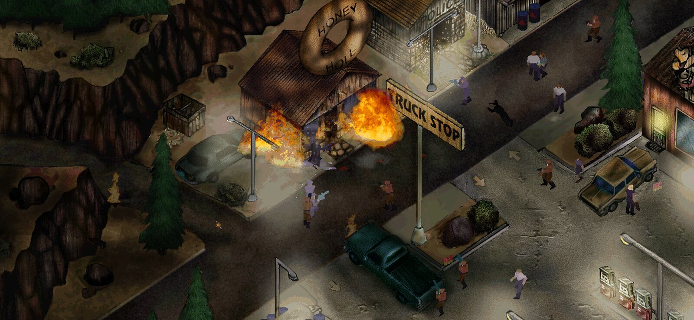
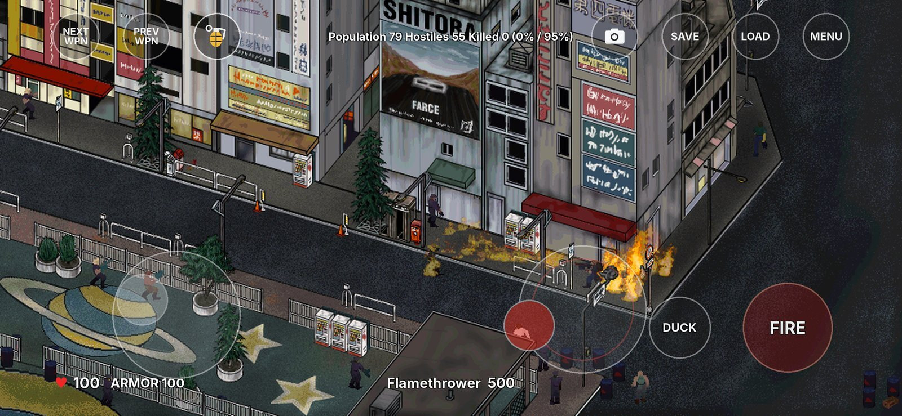
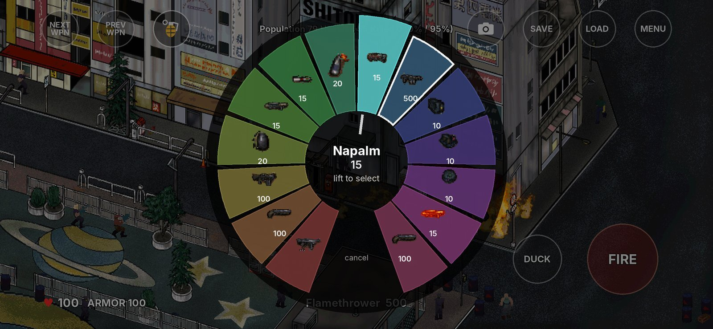
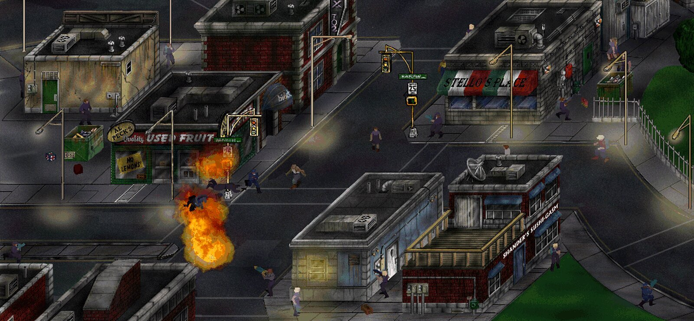
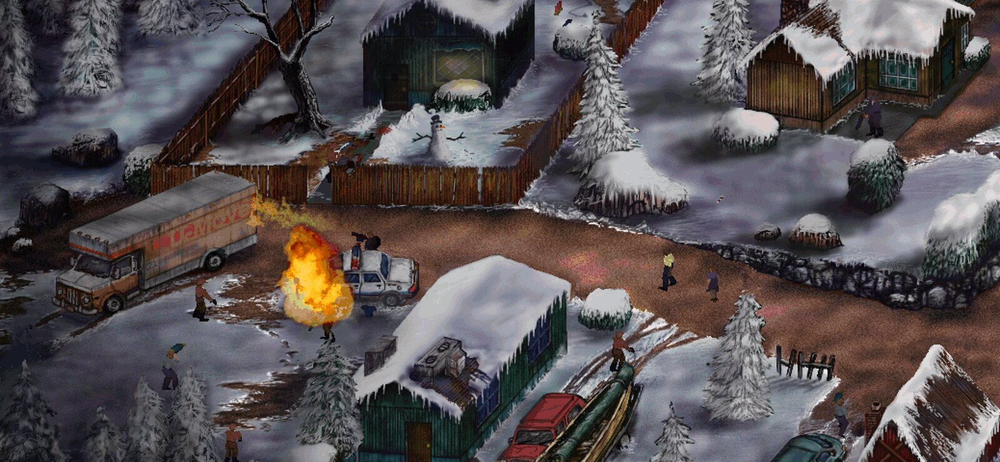
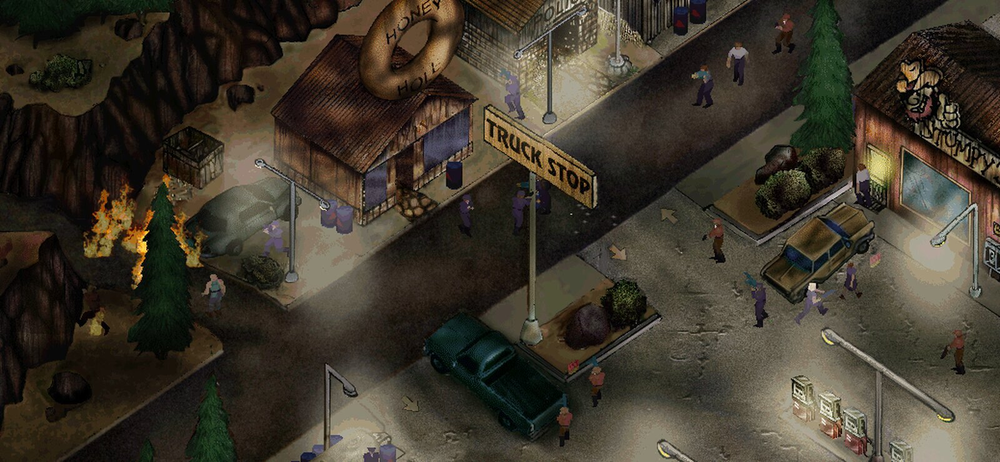
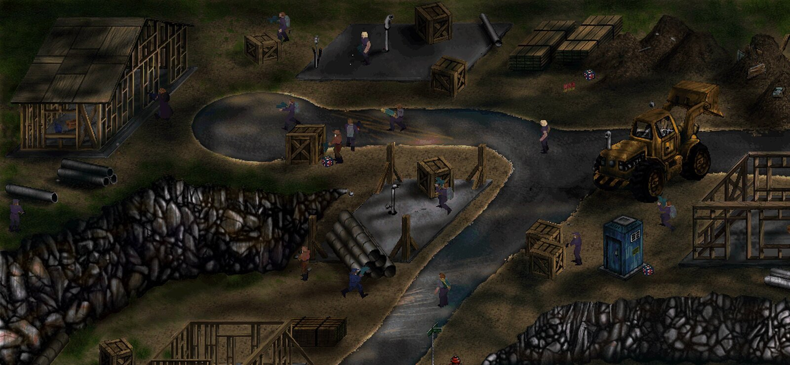

# POSTAL for iPhone and iPad (unofficial port)

Play **POSTAL** (1997), the isometric shooter from Running With Scissors, on iPhone with touch controls made for it. It's an unofficial port of the [POSTAL source code](https://github.com/RWS-Studios/POSTAL-SourceCode) that Running With Scissors released to its fans.



**You need your own copy of POSTAL: Classic and Uncut. Game files are not included.** Buy it on [GOG](https://www.gog.com/game/postal_classic_and_uncut) or [Steam](https://store.steampowered.com/app/232770/POSTAL/), then copy its `res` folder to your iPhone.

## Install

You need an iPhone or iPad with iOS 15 or newer. The app isn't on the App Store, so you install it yourself ("sideloading"). Pick one way:

- **SideStore or AltStore (easiest).** On your iPhone, tap **[Add to SideStore](https://sithewok13-dev.github.io/postal/#add-sidestore)** or **[Add to AltStore](https://sithewok13-dev.github.io/postal/#add-altstore)**, then install POSTAL from there. Updates come the same way.
- **Feather, Sideloadly or another signing tool.** Download `postal-ios.ipa` from the [latest release](https://github.com/sithewok13-dev/POSTAL-SourceCode/releases/latest) and sign it with your tool.
- **The source by hand.** In SideStore, AltStore or Feather, go to *Sources*, tap **+**, and paste this address:

  ```
  https://raw.githubusercontent.com/sithewok13-dev/POSTAL-SourceCode/ios/ios/altstore-source.json
  ```

Then open the app once. It says the game files are missing and makes its folder. In the Files app, copy the `res` folder from your POSTAL install into **On My iPhone > POSTAL**, and open the app again.

AltStore here means AltStore Classic; AltStore PAL can't install it. The newest test build is on the [releases page](https://github.com/sithewok13-dev/POSTAL-SourceCode/releases).

## Cool features

- **Twin-stick touch controls.** Your left thumb moves (push to the edge to run). Your right thumb aims, and pushing it all the way fires. Big FIRE and DUCK buttons, and an EXECUTE button that only shows up when it can do something.
- **The whole screen.** POSTAL draws its own wider view to fit the iPhone, so nothing is stretched.
- **Weapon wheel.** Slide NEXT WPN or PREV WPN and every weapon is there at once, with the game's own icons and ammo counts.
- **Quick save and quick load.** Hold SAVE or LOAD.
- **A cheat button** (a hand grenade): you can't die, you get every weapon with endless ammo, and the secret Deathwad.
- **Jump to any level.** With the cheat on, LEVEL lists all 22 levels of POSTAL: Classic and Uncut, Special Delivery and Super Postal included.
- **Slow motion** at half or quarter speed, and a **follow cam** that watches someone else in the level.
- **Camera button.** One tap saves a screenshot to your Photos, without the buttons.
- **Tap the menus**, with a BACK button, and type the game's own cheat codes on the iPhone keyboard.

All of this is behind the MENU button: tap it for the game's menu, hold it for the rest. The [release notes](https://github.com/sithewok13-dev/POSTAL-SourceCode/releases/latest) explain every control.

<p>






</p>

*All pictures come from the app's game code running on a computer with real game data. In the first two, the touch controls are drawn from the app's own layout code; on an iPhone they look much the same.*

## Sorry about the bugs

This is an unofficial beta, made by a fan, and it has had little testing on real iPhones so far (none on iPad). Expect bugs, and back up your saves (they're in Files > On My iPhone > POSTAL > savegame).

**Multiplayer isn't in the app yet.** In the released source code, network play only works on Windows. A first fix has run on a Linux computer (two copies playing co-op over the network), but it isn't in the iPhone app, and it hasn't been tried between phones. Sorry; it's being worked on.

Found a bug? Please [report it here](https://github.com/sithewok13-dev/POSTAL-SourceCode/issues), not to Running With Scissors.

## Thanks

- **Running With Scissors** made POSTAL and gave its source code to the fans: Vince Desi, Mike Riedel, Jeff Diamond, Bill Harman, Jonathan Isabelle, Randy Briley and the whole team in the game's credits. Thank you for sharing it.
- **Ryan C. Gordon** ([icculus](https://icculus.org/)) moved POSTAL to SDL for Linux and Mac in the 2013 update (his notes are all through the code); this port is built on that work.
- **Emile Belanger** made the Android port; the iPhone menus use its tap-to-choose code. **Lana Foltz** and Emile did the 2015 update.
- **[Mystyle-48](https://github.com/Mystyle-48)** brought the newest open-source changes into [RWS-Studios/POSTAL-SourceCode](https://github.com/RWS-Studios/POSTAL-SourceCode), and **[OtterCodes101](https://github.com/OtterCodes101)** fixed the credits.
- **[SDL](https://www.libsdl.org/)** runs the game's window, sound and input on iPhone.

The code is under the [GNU GPL v2](https://github.com/sithewok13-dev/POSTAL-SourceCode/blob/ios/LICENSE), as Running With Scissors released it. Not affiliated with or endorsed by Running With Scissors.

---

*The original README from Running With Scissors follows, unchanged.*

It was in September, 1997 – over 20 years ago – when us humble folk from Running With Scissors unleashed our Robotron-inspired isometric shooter POSTAL to the unsuspecting public at large. It was an instant hit, grabbing the attention of gamers, parents and politicians across the country, and we’ve been supporting and updating it ever since. 20 years later, we've entrusted our fans with the future of our game, by releasing its source code to the public.
